# Wazuh SOC Home Lab

A small Security Operations Center (SOC) lab built using **UTM**, **Ubuntu 22.04**, and **Wazuh**. One VM runs the Wazuh SIEM; a second runs a Wazuh agent as a monitored endpoint. Both VMs run in UTM on a shared network. The agent ships logs and alerts to the SIEM; the dashboard is viewed from the browser. I generated real security events on the endpoint and investigated each one in the dashboard, writing an analyst note for every detection.

## What I did

- Installed and configured a Wazuh all-in-one SIEM.
- Enrolled a Linux endpoint agent.
- Simulated and investigated four attack types: brute-force logins, privilege escalation, account creation, and file tampering.
- Wrote analyst notes mapping each alert to its meaning, severity, and verdict.
- Tuned detection: enabled real-time File Integrity Monitoring.

## Skills demonstrated

Log analysis · SIEM operations · alert triage · Linux administration · detection tuning

---

## Exercise 1 — Brute-force login

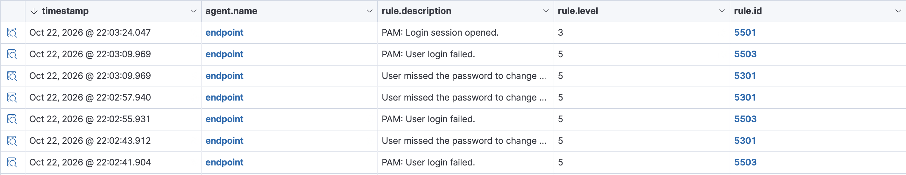

The SIEM shows several failed logins (rule `5503`) followed by a successful session (`5501`). An example of a brute-force pattern that succeeded.

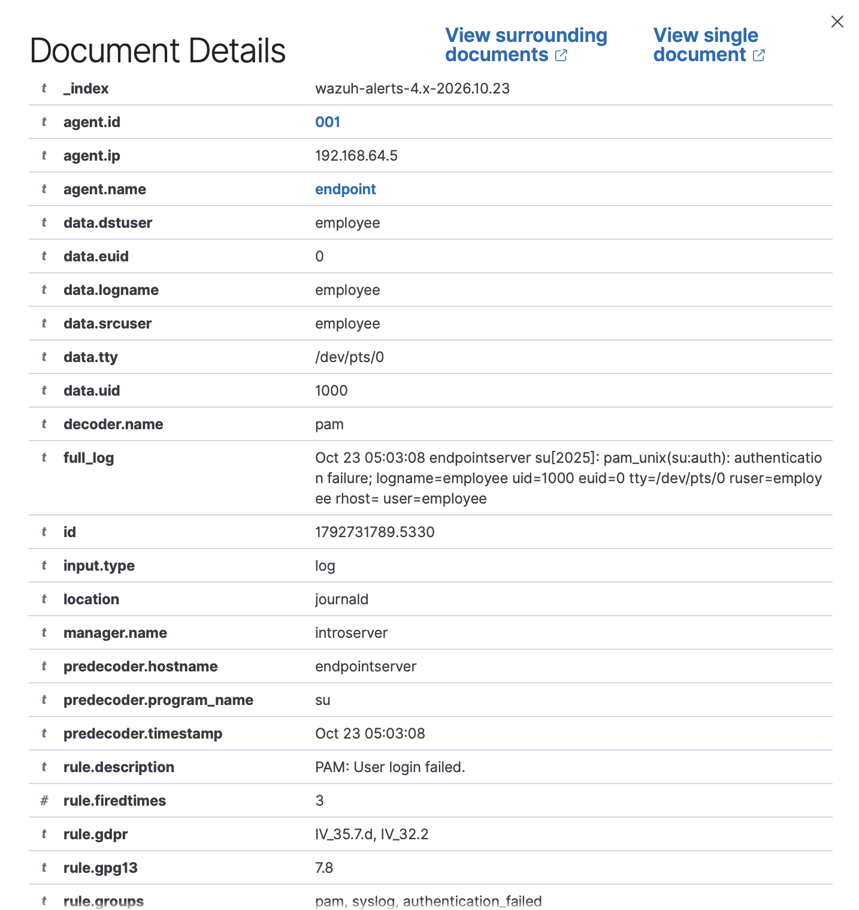
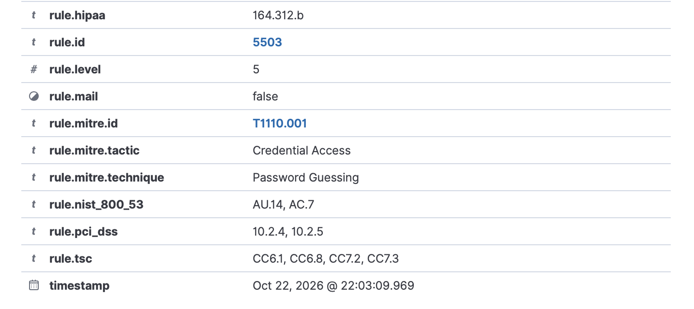

**Analyst note — Verdict: True Positive · Severity: Medium.**
On the endpoint (`192.168.64.5`), local user `employee` failed to log in three times within about 20 seconds and then logged in successfully. The burst of failures immediately followed by a success is the signature of a brute-force attempt that guessed the password, so I assess it as a likely account compromise that worked, and flag it to confirm whether `employee` actually performed it. Rules: `authentication_failed` group (5503), then 5501 (session opened).

---

## Exercise 2 — Account creation

A privilege escalation (`5402`) is immediately followed by a new group (`5901`) and new user (`5902`), both level 8.

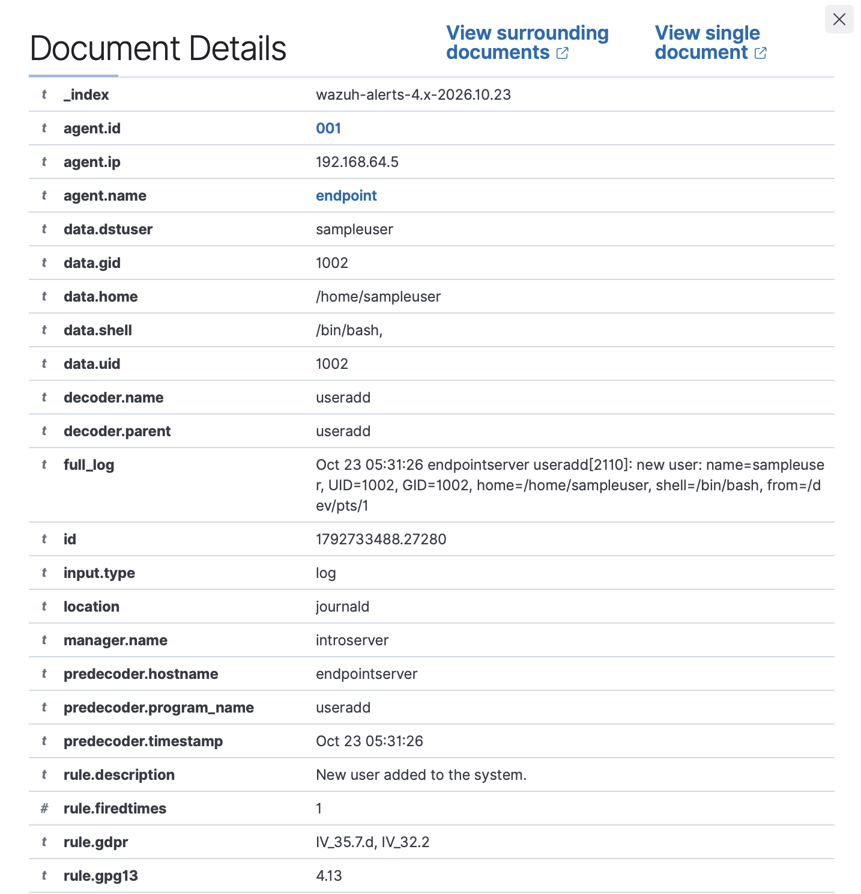
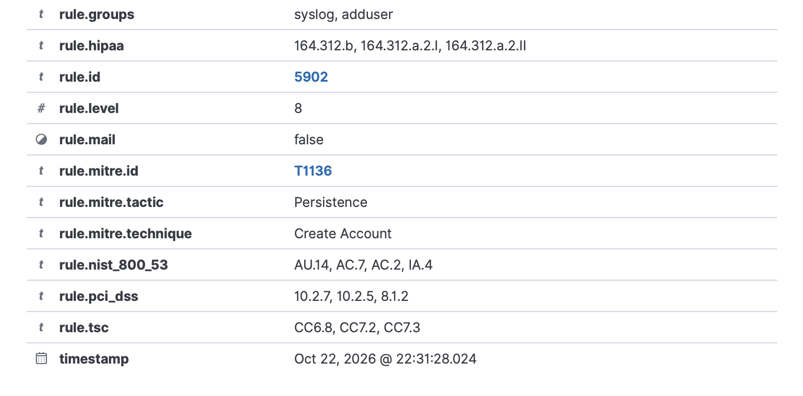

**Analyst note — Verdict: True Positive · Severity: High.**
On the endpoint (`192.168.64.5`), local user `employee` escalated to root with `sudo` (rule 5402) and in the same second created a new account `testuser` and its group (rules 5902 / 5901, level 8), then set its password. A root escalation immediately followed by creating a new account is a classic persistence move — a login an intruder can reuse later — and with no change ticket behind it I assess it as a true positive and escalate to confirm who authorized the account and why.

---

## Exercise 3 — Privilege use (sudo to read /etc/shadow)

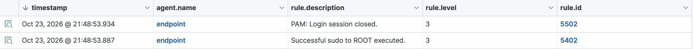

User escalated to root and read the password-hash file.

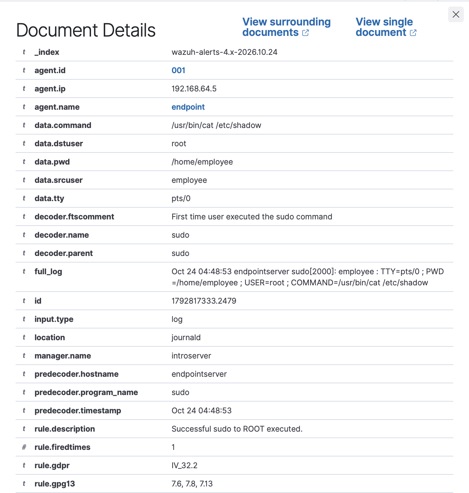
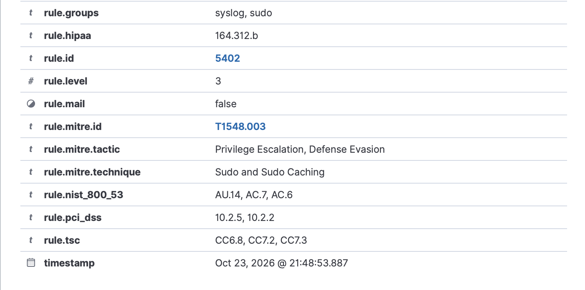

**Analyst note — Verdict: Suspicious, pending confirmation · Severity: Medium.**
On the endpoint (`192.168.64.5`), local user `employee` escalated to root and read `/etc/shadow`, the password-hash file (rule 5402). Reading `/etc/shadow` exposes credential hashes that can be cracked offline, so I treat the access as sensitive and verify whether it was authorized. The sudo `full_log` captured the exact command, including the target file — useful for scoping. (For file access that does not go through sudo, auditd rules on sensitive files would add the same visibility.)

---

## Exercise 4 — File integrity monitoring (/etc/hosts tampering)

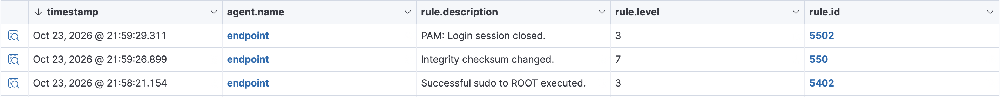

Wazuh FIM flags a change to a monitored file (rule `550`, "Integrity checksum changed").

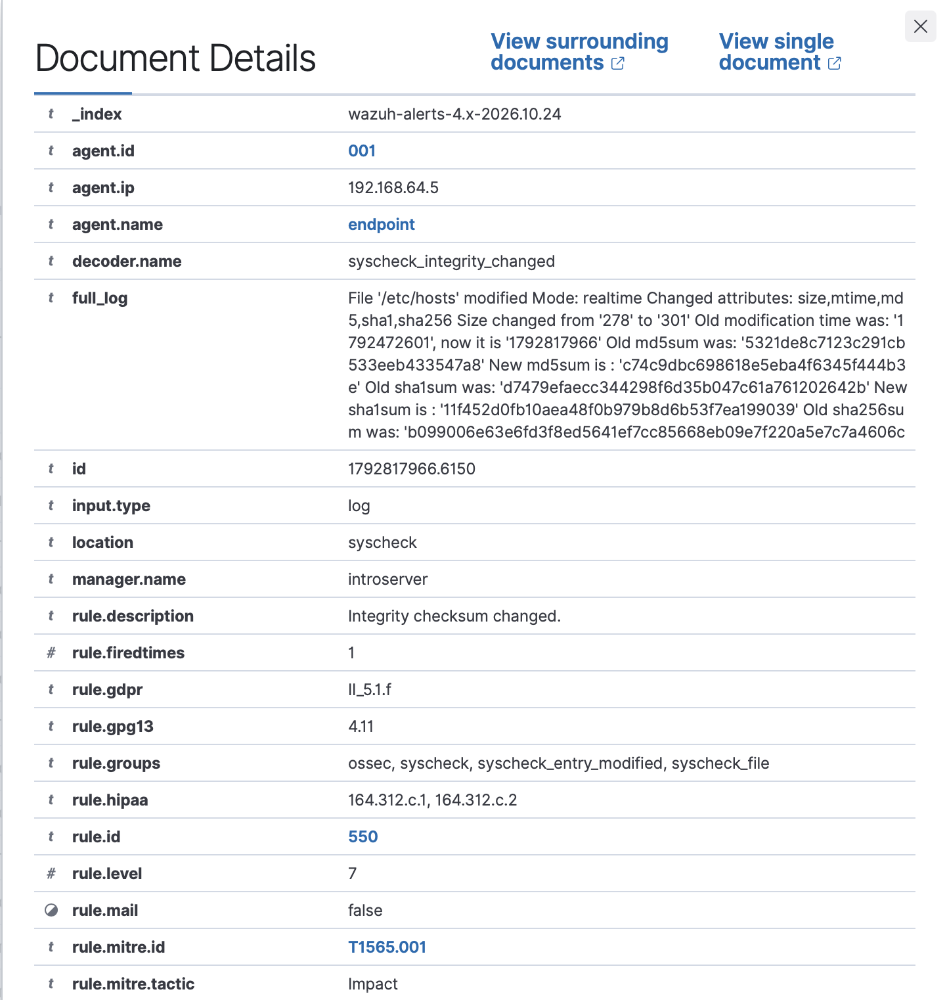
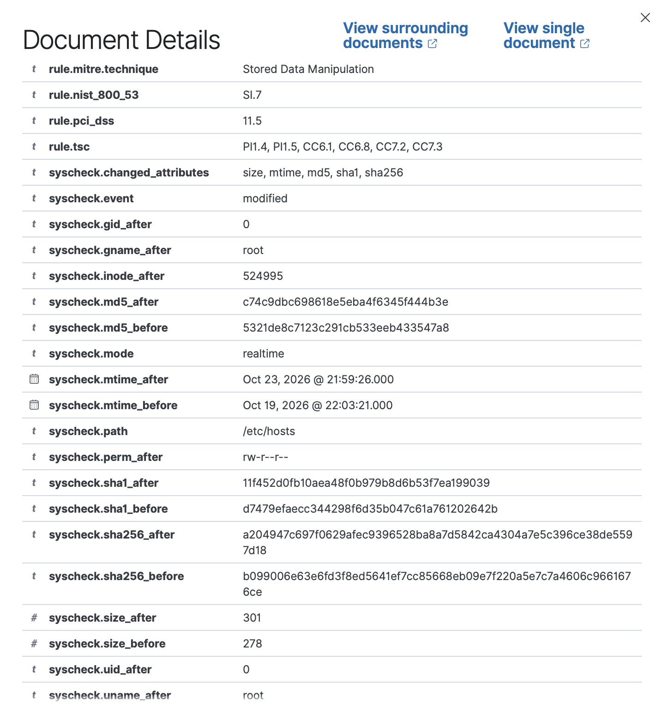

**Analyst note — Verdict: True Positive · Severity: High.**
On the endpoint (`192.168.64.5`), `/etc/hosts` was modified as root, adding a mapping to an unknown domain (rule 550, level 7, group `syscheck`; `syscheck.path: /etc/hosts`). Because `/etc/hosts` controls name resolution, a malicious entry can silently redirect traffic to an attacker-controlled server, so I rate it high priority and recommend confirming who made the change and reverting it if unapproved. Detection was near-instant because `/etc` was switched from the default 12-hour scan to real-time FIM.

---

