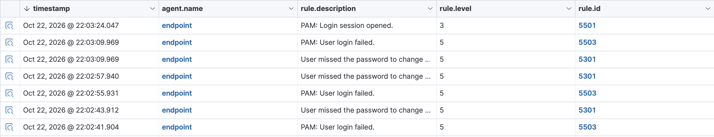
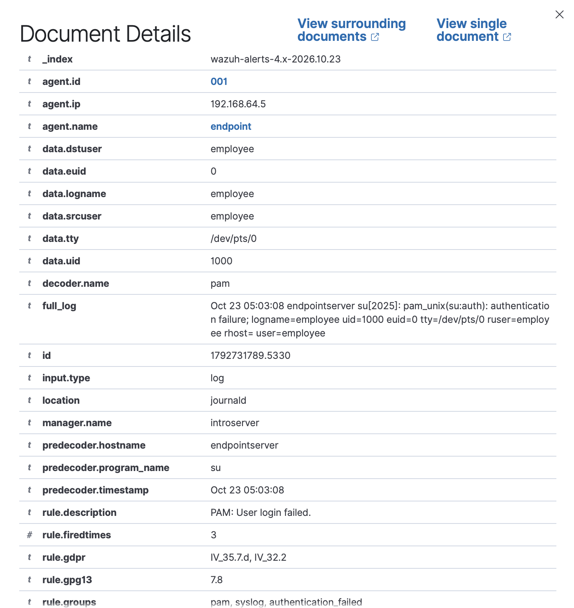
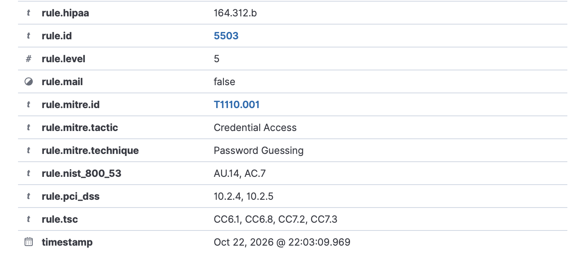
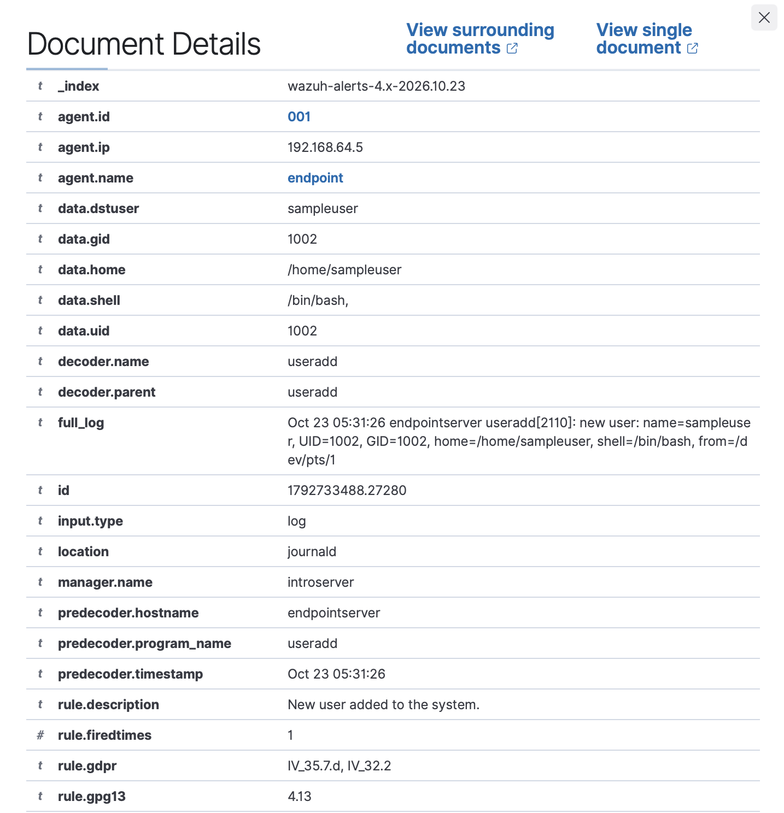
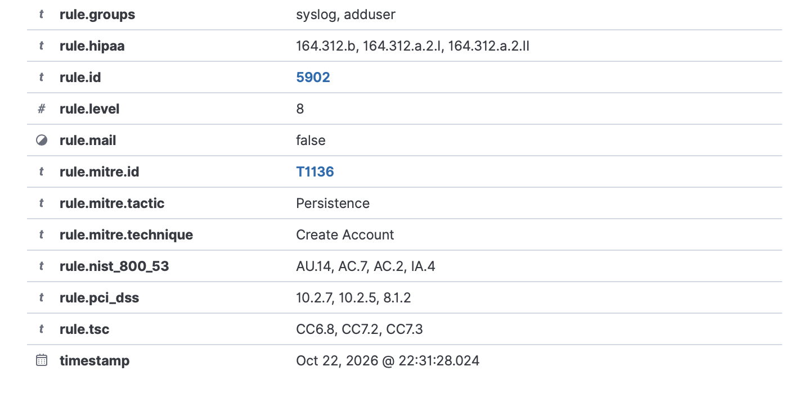
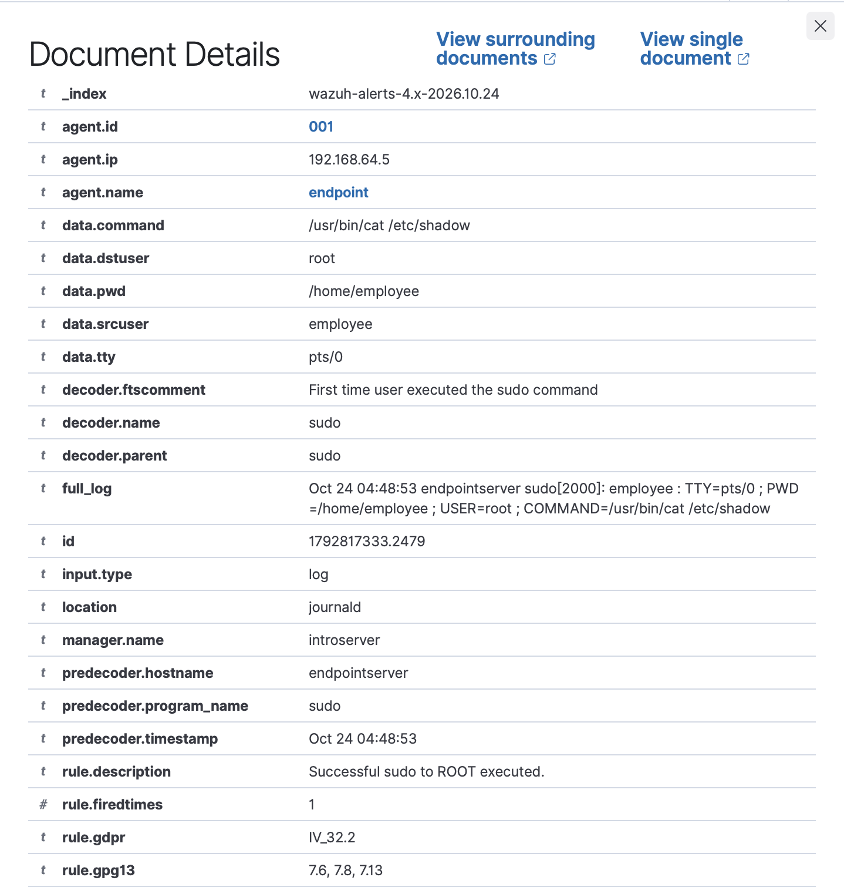
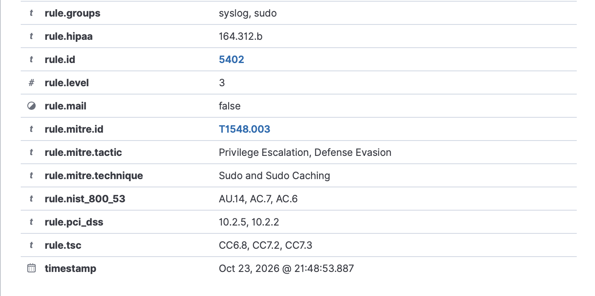
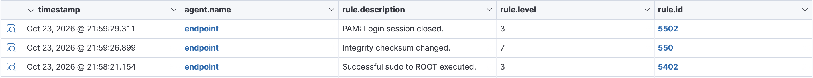
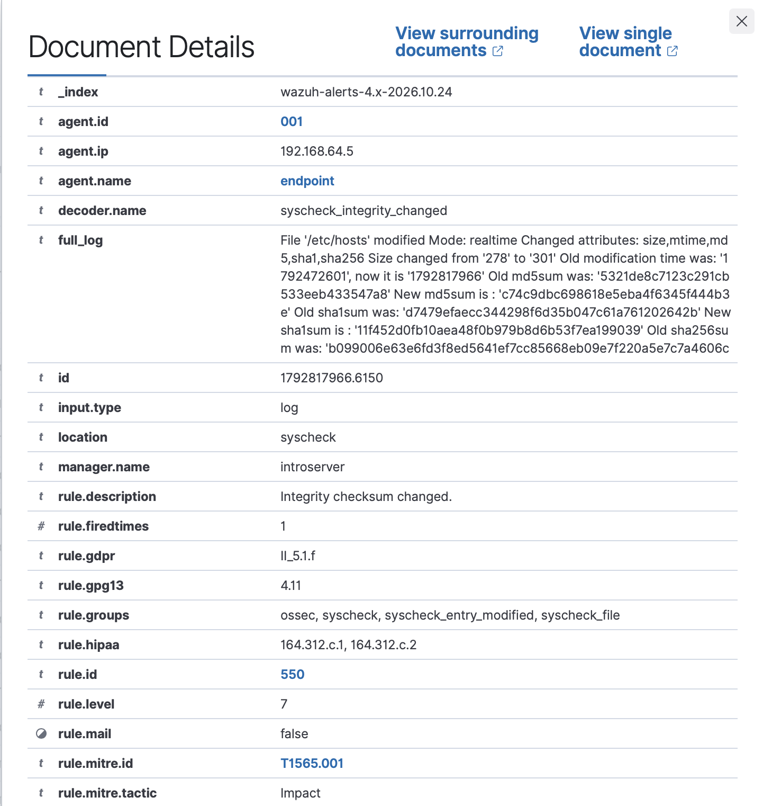
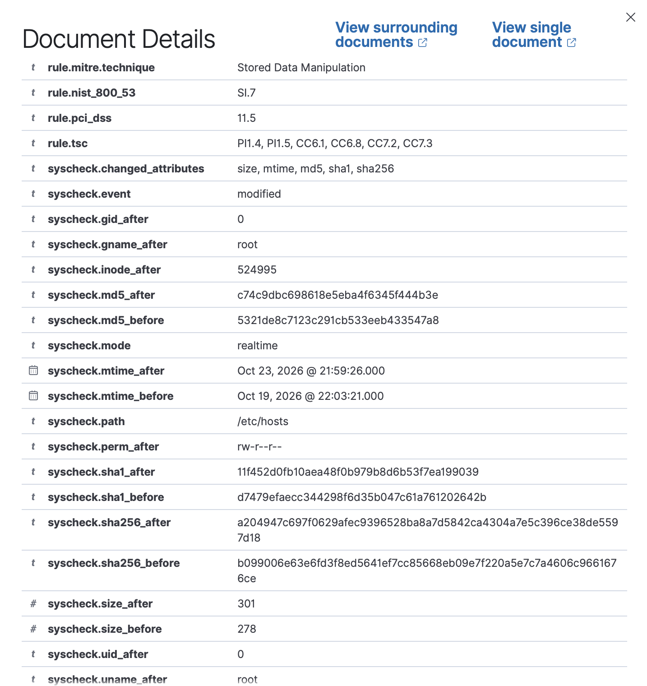

# Wazuh SOC Home Lab

A small Security Operations Center (SOC) lab built using **UTM**, **Ubuntu 22.04**, and **Wazuh**. One VM runs the Wazuh SIEM; a second runs a Wazuh agent as a monitored endpoint. Both VMs run in UTM on a shared network. The agent ships logs and alerts to the SIEM; the dashboard is viewed from the browser. I generated real security events on the endpoint and investigated each one in the dashboard, writing an analyst note for every detection.

## Architecture
Network diagram
- wazuh-siem - Ubuntu 22.04.5, Wazuh manager + indexer + dashboard — 192.168.64.4
- endpoint - Ubuntu 22.04.5, Wazuh agent — 192.168.64.5
- Both VMs run in UTM on a shared network. The agent ships logs and alerts to the SIEM; the dashboard is viewed from the Mac browser.

## What I did

- Installed and configured a Wazuh all-in-one SIEM.
- Enrolled a Linux endpoint agent.
- Simulated and investigated four attack types: brute-force logins, privilege escalation, account creation, and file tampering.
- Wrote analyst notes mapping each alert to its meaning, severity, and verdict.
- Tuned detection: enabled real-time File Integrity Monitoring.

## Skills demonstrated

Log analysis, SIEM operations, alert triage, Linux administration, detection tuning

---

## Exercise 1 — Brute-force login

The SIEM shows several failed logins (rule `5503`) followed by a successful session (`5501`). An example of a brute-force pattern that succeeded.

**Analyst note - Verdict: True Positive, Severity: Medium.**
On the endpoint (`192.168.64.5`), local user `employee` failed to log in three times within about 15 seconds and then logged in successfully. The consecutive failures immediately followed by a success is a sign of a brute-force attempt that guessed the password, so I assess it as a likely account compromise that worked, and flag it to confirm whether `employee` actually performed it. 

## Exercise 2 — Account creation

A privilege escalation (`5402`) is immediately followed by a new group (`5901`) and new user (`5902`), both level 8.

**Analyst note - Verdict: True Positive, Severity: High.**
On the endpoint (`192.168.64.5`), local user `employee` escalated to root with `sudo` (rule 5402) and in immediately created a new account `testuser` and its group, then set its password. Attackers normally do this so they can reuse the login later. I assess it as a true positive and escalate to confirm who authorized the account and why.

---

## Exercise 3 — Privilege use (sudo to read /etc/shadow)

User escalated to root and read the password-hash file.

**Analyst note — Verdict: Suspicious, pending confirmation,  Severity: Medium.**
On the endpoint (`192.168.64.5`), local user `employee` escalated to root and read `/etc/shadow`, the password-hash file (rule 5402). Reading `/etc/shadow` exposes credential hashes that can be cracked offline, so I treat the access as sensitive and verify whether it was authorized. 

---

## Exercise 4 — File integrity monitoring (/etc/hosts tampering)

Wazuh FIM flags a change to a monitored file (rule `550`, "Integrity checksum changed").

**Analyst note — Verdict: True Positive, Severity: High.**
On the endpoint (`192.168.64.5`), `/etc/hosts` was modified as root, adding a mapping to an unknown domain. Because `/etc/hosts` controls name resolution, a malicious entry can silently redirect traffic to an attacker-controlled server, so I rate it high priority and recommend confirming who made the change and reverting it if unapproved. Detection was near-instant because `/etc` was switched from the default 12-hour scan to real-time FIM.

---

